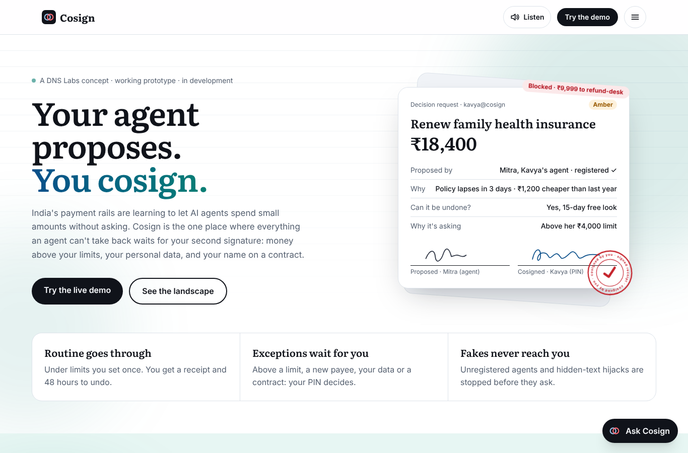

# Cosign — your agent proposes, you cosign

[](https://github.com/DineshSundrani7/cosign/actions/workflows/ci.yml)

A product I'm building at **DNS Labs** — Dinesh Sundrani. Status: **concept, clickable prototype and a working v0 backend · in development.**

**Live site:** add your Vercel link here

By 2040, personal AI agents pay, sign and share for us. India's payment rails (UPI mandates, Reserve Pay, NPCI's agent protocol) are learning to let agents spend small amounts without asking. **Cosign is the one place where everything an agent can't take back waits for your second signature**: money above your limits, your personal data, and your name on a contract.



## What's in this repo

| Folder | What it is | Real or simulated |
|---|---|---|
| `server/` | Cosign v0 backend: signed agent requests, policy engine, PIN-locked device keys, single-use approval tokens, a mock bank, hospital and e-sign desk that each refuse without a cosign, Family Circle approvals, seller-claim checks, 48-hour undo and disputes, a hash-chained receipt log, an MCP connector for real AI assistants, SQLite persistence, input validation, live metrics, an OpenAPI spec and 21 tests | Logic, signatures and checks are real; the bank and money are simulated |
| `src/` + `docs/index.html` | The website and its clickable phone prototype | Demo data is simulated |
| `design/SPEC.md` | Draft request and token format, mapped to Google AP2, OpenID CIBA and UPI mandates | — |
| `design/SECURITY.md` | How someone would attack Cosign and what stops them | — |
| `design/openapi.yaml` | Full API description (OpenAPI 3.1) | — |

Try the backend in one minute:

```bash
cd server && npm install && npm run demo
```

## How I built this with AI

Claude did the research legwork and wrote most of the code. I set the direction and made the product calls: the problem, the pivot from "a new payment rail" to "the person's decision layer on top of existing rails" after the competitor research, the name, and what to leave out.

## What's in the site

| Section | What it covers |
|---|---|
| Journey | Scroll-driven timeline from 2010 to 2040 with a moving marker |
| Problem | Why rails alone don't protect people, with market data |
| Two doors | Who it's for: families directly first, banks and UPI apps next (animated) |
| How it works | Decision address, PIN, number-matching, signed receipts, four tiers |
| Under the hood | The 7-step request pipeline and the standards it builds on |
| Try the real engine | A browser port of the v0 engine: real Ed25519 signatures, PIN lock and bank checks you can click through |
| Demo | A working phone prototype with 7 scenarios (any 4-digit PIN works) |
| Landscape | Payment rails, developer approval gateways and data-consent infrastructure, and where Cosign fits |
| The persona | Kavya, 41, a schoolteacher in Nagpur, and her mother |
| Metrics | North Star (protected-action rate), regret rate, guardrails, first test |
| Go to market | Families first, banks next; who pays by year; risks |
| Build log | How it was made with AI, step by step |
| About | DNS Labs and Dinesh Sundrani |
| FAQ | Common questions (the same list powers the chat assistant) |

All people, agents and sellers in the demo are fictional.

## Deploy free on Vercel

1. Put this folder in a GitHub repository (github.com/new → "uploading an existing file", drag everything in, commit). Don't upload `node_modules`.
2. Sign in at vercel.com with GitHub → **Add New → Project** → import the repository.
3. Vercel reads `vercel.json` (build: `npm run build`, output: `docs`). Click **Deploy**. You get a free `*.vercel.app` link on the Hobby plan.

GitHub Pages also works: Settings → Pages → deploy from branch `main`, folder `/docs`.

After deploying, change `og:image` in `index.html` to the full address (for example `https://your-app.vercel.app/og.png`) so WhatsApp and LinkedIn show the preview card, then rebuild.

## The Ask Cosign chat

The chat button answers from the FAQ in `src/components/cosign/faq.ts` — edit that file to change its answers. When the page runs on claude.ai it uses Claude for the answers; on Vercel it answers instantly from the FAQ, at no cost. For a live AI chatbot on Vercel you need an AI provider API key and a small server function, which costs money per message.

## Accessibility

- **Listen button** in the top bar reads the page aloud with the browser's built-in voice (Web Speech API). It's free, needs no server and highlights each part as it reads. It skips the interactive demo.
- **Screen readers** (VoiceOver, TalkBack, NVDA) work with the page structure: real headings, labelled buttons and menus, a "Skip to demo" link, keyboard focus outlines, and live updates in the demo and chat.
- An automated WCAG 2.1 AA check (axe-core) found no violations. A real screen-reader test by a person is still worth doing.

## Edit and rebuild

Needs Node.js 20+.

```bash
npm install
npm run dev      # live preview at http://localhost:5173
npm run build    # rebuilds docs/
```

- `src/components/cosign/Sections.tsx` — every section of the site
- `src/components/cosign/Demo.tsx` — the phone prototype
- `src/components/cosign/Stamp.tsx` — logo mark, seal, signatures
- `src/components/cosign/Chat.tsx` — chat assistant and FAQ section
- `src/components/cosign/Listen.tsx` — read-aloud button
- `src/components/cosign/Journey.tsx` — the 2010–2040 timeline
- `src/components/cosign/Doors.tsx` — the two-doors section
- `src/components/cosign/engine.ts` + `LiveEngine.tsx` — the in-browser engine
- `src/components/cosign/Deep.tsx` — Under the hood and Build log
- `src/styles.css` — colours and fonts

The built site in `docs/` also opens offline: double-click `docs/index.html`.

## Notes

- Several 2026 facts come from news reports. NPCI had not formally published the Unified Agent Protocol's details when they were written. Check the sources section before relying on them.
- Typefaces: Literata and Inter via Fontsource (SIL Open Font License). Libraries: React, Framer Motion, Tailwind CSS, Vite.
